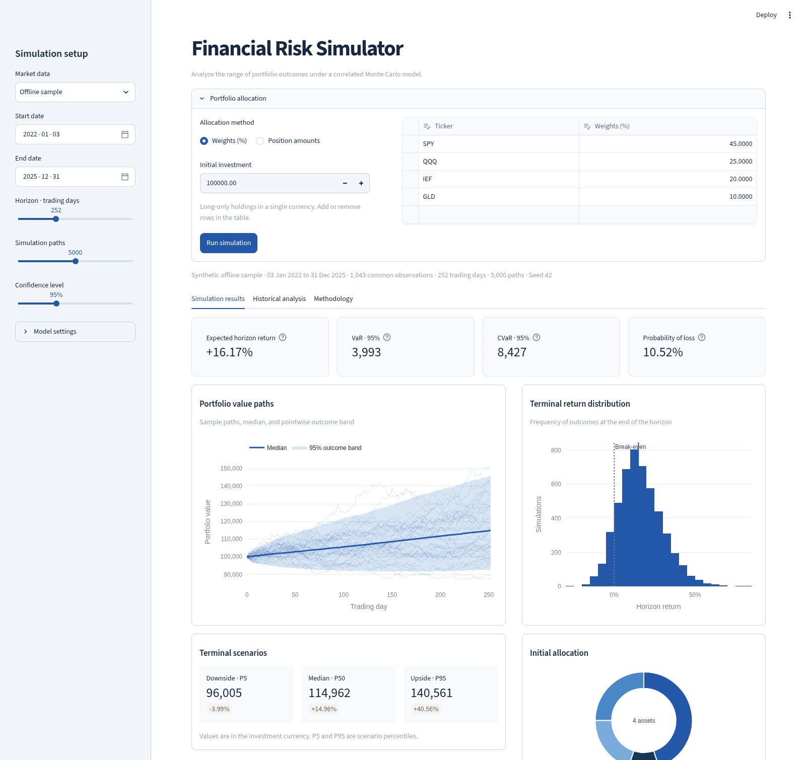
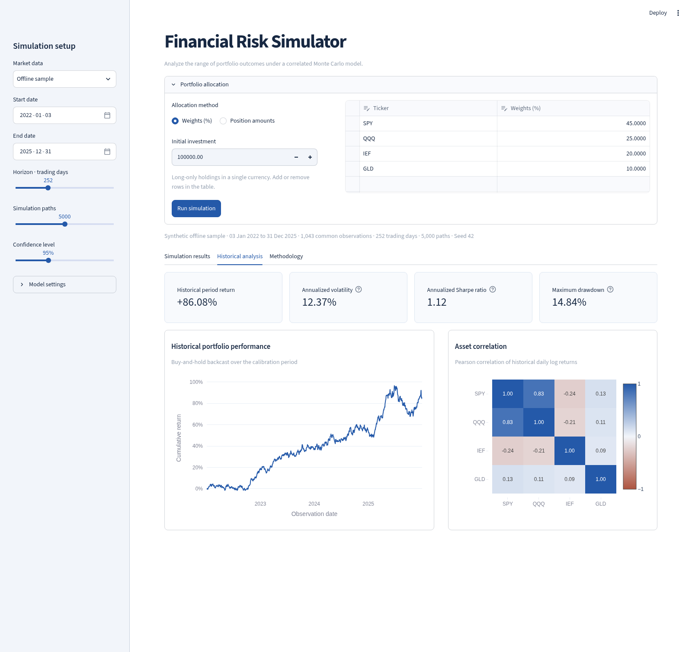

# Financial Risk Simulator

A Streamlit dashboard for evaluating the range of possible outcomes of a long-only investment portfolio. It uses adjusted Yahoo Finance prices or a bundled synthetic dataset to calibrate and run a correlated Monte Carlo simulation. Simulations do not predict future returns.

## Quick start

Install [Python 3.12](https://www.python.org/downloads/) and open a terminal in the project folder containing `app.py` and `requirements.txt`. If you received a ZIP, extract it first.

On macOS and Linux:

```bash
python3.12 -m venv .venv
source .venv/bin/activate
python -m pip install -r requirements.txt
python -m streamlit run app.py
```

On Windows PowerShell:

```powershell
py -3.12 -m venv .venv
.venv\Scripts\python.exe -m pip install -r requirements.txt
.venv\Scripts\python.exe -m streamlit run app.py
```

Open the local URL printed by Streamlit, usually `http://localhost:8501`.

The dashboard runs the offline example on startup. Choose **Yahoo Finance** for adjusted daily closes, then choose a calibration period and enter one to twelve ticker symbols. Use **Weights (%)** with a total of 100% and an initial investment, or use **Position amounts** to derive weights and total investment from the amounts entered. All positions must be positive. Add or remove rows in the portfolio table. Choose the horizon, path count, confidence level and seed, then select **Run simulation**. The seed makes a run reproducible for unchanged calibration data and dependencies.

- **Simulation results** shows terminal risk estimates, selected paths, a pointwise outcome band, return distribution, allocation, and terminal percentiles.
- **Historical analysis** shows a buy-and-hold backcast, annualized volatility, Sharpe ratio, drawdown and the asset correlation matrix.
- **Methodology** explains the metrics and limitations.

## Screenshots

Both screenshots show the running app with the bundled synthetic dataset and the default allocation.





## Methodology

### Data and calibration

Yahoo Finance prices are adjusted for splits and distributions using yfinance. The start and end dates are inclusive. The data layer aligns the series on common dates, removes nonpositive and missing prices, and requires at least 30 shared observations. Prices are cached for one hour by source, symbols and dates. Each pair of successive common closes is treated as one trading-day step. For assets with different market calendars or missing observations, a step may span multiple trading days.

The bundled offline CSV contains reproducible, synthetic weekday series from January 2020 through December 2025. Its column names use familiar ETF symbols for illustration. The sample values are generated from a fixed seed and a correlated factor model and do not represent observed ETF prices or exchange holidays.

### Correlated geometric Brownian motion

For asset *i* and common date *t*, compute the daily log return `r[i,t] = log(P[i,t] / P[i,t-1])`. Estimate the vector of sample means `m` and the sample covariance matrix `Σ` with denominator `n − 1`. For each path and trading day independently, draw `z ~ N(0, I)` and set `Δlog(P) = m + Lz`, where `LLᵀ = Σ`. An eigenvalue square root handles singular covariance. Small negative eigenvalues from floating-point roundoff are clipped to zero.

In the continuous-time GBM convention, the corresponding daily arithmetic drift parameter is `μ[i] = m[i] + Σ[i,i]/2`, since the log increment already includes the Itô correction. The engine samples log increments directly and compounds each asset. Portfolio value on trading day *t* is `V[t] = C × Σᵢ w[i] exp(Σₛ₌₁ᵗ Δlog(P[i,s]))` for starting capital *C* and weights *w*. Initial holdings are fixed and weights drift across the horizon.

### Risk estimates

| Metric | Definition |
| --- | --- |
| Expected horizon return | Sample mean of `V[T]/C − 1` across simulated paths. |
| Probability of loss | Share of simulations with `V[T] < C`. |
| VaR at confidence *c* | Inverse empirical CDF at *c* for losses `C − V[T]`, in the investment currency. A negative VaR represents a gain at that quantile. |
| CVaR at confidence *c* | Average of the largest `(1 − c) × N` simulated losses, with fractional weight on the boundary observation when required. |
| Downside, median and upside | P5, P50 and P95 of terminal values using linear interpolation. |
| Outcome band | Pointwise percentiles `(1 − c)/2` and `(1 + c)/2` at each day. This is a model outcome interval. It does not provide simultaneous coverage of a full path or quantify uncertainty in the fitted parameters. |
| Annualized historical volatility | Sample standard deviation of historical daily simple portfolio returns multiplied by `√252`. |
| Historical Sharpe ratio | Average daily excess return divided by daily sample standard deviation, multiplied by `√252`. The effective annual risk-free rate is converted to an effective daily rate via `(1 + rate)^(1/252) − 1`. Zero volatility makes Sharpe undefined. |
| Historical maximum drawdown | Largest `1 − V[t]/running_max(V)[t]` in the historical backcast. |
| Correlation | Pearson correlation of daily historical asset log returns. Constant series have undefined correlation. |

The historical portfolio uses the same starting weights at the first retained date and values those fixed holdings through the calibration period. It is a backcast of today’s selected allocation and has selection and survivorship limitations. The simulation assumes stationary drift, volatility and correlation, independent Gaussian increments over time, 252 trading days per year, and no rebalancing. It omits trading costs, taxes, cash flows, liquidity constraints and currency conversion. Estimated drift can be noisy, and the model can underestimate jumps, volatility clustering and extreme losses. Tail estimates become less stable with fewer paths or higher confidence levels.

## Architecture

| Path | Responsibility |
| --- | --- |
| `app.py` | Streamlit controls, run state and dashboard layout. |
| `risk_simulator/market_data.py` | Ticker validation, cached retrieval, offline data and calendar alignment. |
| `risk_simulator/simulation.py` | Log-return calibration and seeded correlated GBM paths. |
| `risk_simulator/analytics.py` | Allocation validation, historical backcast and risk statistics. |
| `risk_simulator/charts.py` | Plotly figures. |
| `data/sample_prices.csv` | Bundled synthetic data for offline use. |
| `tests/` | Deterministic unit tests with no network dependency. |
| `.github/workflows/tests.yml` | GitHub Actions workflow for pushes and pull requests. |

## Tests

```bash
python -m pytest -q
```

Tests cover allocation, data alignment, risk formulas, seeded replay, singular covariance and simulated expectations against the analytical GBM mean.

## License

[MIT](LICENSE)
